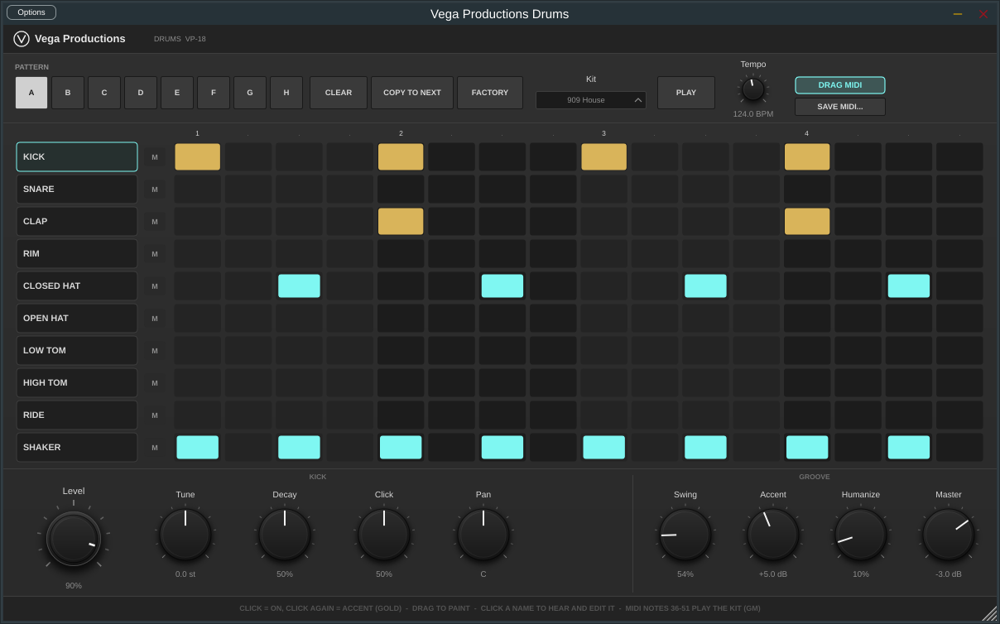

# Vega Productions Drums (VP-18)

Analog-style drum machine (909 / 808 / Deep House kits, fully synthesized) with a 16-step sequencer, swing, accents and a separate output for every drum.



## Download
- **Windows (FL Studio):** https://github.com/DJVega70/vega-drums/releases/latest/download/VegaProductions-Drums-Windows-VST3.zip
- **macOS:** https://github.com/DJVega70/vega-drums/releases/latest/download/VegaProductions-Drums-macOS-VST3-AU.zip

## Features
- **10 voices:** Kick, Snare, Clap, Rim, Closed Hat, Open Hat (choked by the closed hat), Low Tom, High Tom, Ride, Shaker — each with Level, Tune (±12 st), Decay, Tone/Click/Snappy and Pan, plus Mute.
- **3 kits:** 909 House (punchy), 808 Deep (long boom), Deep House (rounded).
- **Step sequencer:** 8 patterns (A–H) × 16 steps, click for a hit, click again for an accent (gold), drag to paint. Factory patterns: House, Deep, 2-Step Garage, Techno, Tech House, Disco, Breakbeat.
- **Groove:** Swing (50–75%), Accent amount, Humanize (timing + velocity, the kick stays on the grid).
- **Follows FL Studio's transport**; the Pattern parameter can be automated to switch patterns in the playlist. PLAY + Tempo for the stand-alone app.
- **Play it from MIDI:** General MIDI drum notes (36 kick, 38 snare, 39 clap, 42/46 hats…) so the piano roll works too.
- **DRAG MIDI / SAVE MIDI** exports the current pattern as a MIDI clip.
- **Multi-out:** 11 stereo outputs (main + one per drum). In FL Studio: wrapper settings → Processing → enable the outputs and route each to its own mixer track. Drums whose output is off play on the main output.

## Building
```
cmake -B build -DVEGA_TESTS=ON
cmake --build build --config Release --target VegaDrums_VST3 VegaDrumsTest
```
